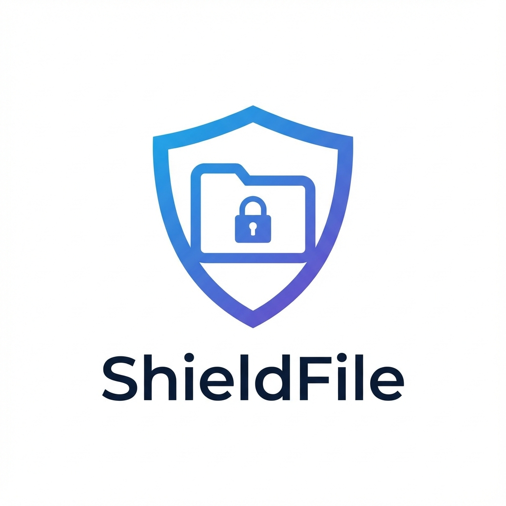

# ShieldFile 🛡️📂


**ShieldFile** is a high-performance, secure, web-based file manager designed to run anywhere. It provides an intuitive "SFTP-like" interface directly in your browser, secured via HTTPS.



> **Powered by [Filebrowser](https://filebrowser.org/)** ❤️
> ShieldFile wraps the amazing Filebrowser project in a "Secure-by-Default" container optimized for private cloud usage.

## ❓ Why "ShieldFile"?

While Filebrowser is the engine, ShieldFile is the **Vehicle**:
1.  **Security First**: Comes with tools to auto-generate SSL certs or enforce TLS usage easily.
2.  **Branding**: A consistent "Shield" identity for your private applications.
3.  **Ready-to-Run**: Pre-configured defaults for generic Docker or Home Assistant usage without complex setup.

## ✨ Features

- **🚀 Blazing Fast**: Built on Go, runs as a single binary.
- **🔒 Secure by Design**: Optimized for HTTPS usage behind proxies or tunnels.
- **📂 Full Control**: Upload, download, rename, move, and edit files effortlessly.
- **📱 Responsive**: Works perfectly on Desktop, Tablet, and Mobile.
- **🐳 Docker Native**: Runs anywhere Docker runs.

---

## 🚀 Quick Start (Docker)

Spin up ShieldFile in seconds using Docker Compose.

### `docker-compose.yml`

```yaml
version: '3.8'

services:
  shieldfile:
    image: ghcr.io/faserf/shieldfile:latest
    container_name: shieldfile
    restart: unless-stopped
    ports:
      - "8443:8080"
    volumes:
      - ./data:/data              # The folder you want to manage
      - ./config:/config          # Configuration files
      - ./db/filebrowser.db:/database.db  # Persist User Database
    environment:
      - FB_PORT=8080
      - FB_ROOT=/data
      - FB_USER=admin
      - FB_PASS=changeme      # CHANGE THIS ON FIRST RUN!
```

Run it:
```bash
docker-compose up -d
```

Access it at: `http://localhost:8443`

---

## 🛡️ Security & Access

### Login & Auth
 ShieldFile is protected by a **Login Screen**.
- **Auth**: Database-backed authentication.
- **Brute Force Protection**: Filebrowser has rate limiting (configurable).
- **Session Management**: Secure cookies.

### Best Practices for Public Access
1. **HTTPS is Mandatory**: Never expose ShieldFile via HTTP.
2. **Reverse Proxy**: Use Nginx, Traefik, or Cloudflare Tunnel.
3. **Cloudflare Access**: Add an extra layer of SSO/2FA authentication if exposing globally.

---

## 📄 License
MIT License.

## Credits
Based on [Filebrowser](https://github.com/filebrowser/filebrowser).
